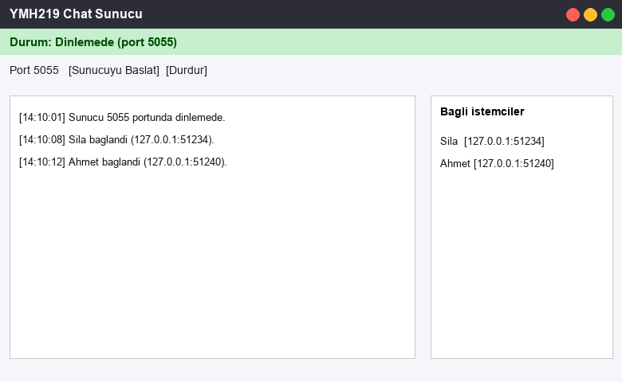
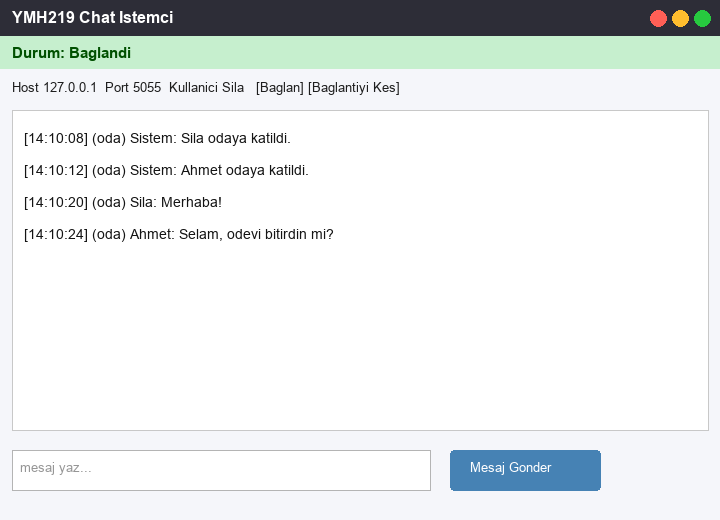

# YMH219-ChatApp

TCP tabanlı istemci-sunucu sohbet uygulaması. Aynı çözüm içinde `ChatServer`, `ChatClient` ve ortak `ChatCommon` projeleri vardır. Aynı bilgisayarda (`127.0.0.1`) veya yerel ağda çalışır.

**Öğrenci:** Sıla Ağgül  
**Öğrenci No:** 250541020  
**Ders:** Nesne Tabanlı Programlama (YMH 219)

## Kullanılan teknolojiler

- C# / .NET 8
- Windows Forms
- `TcpListener` / `TcpClient`
- `StreamReader` / `StreamWriter`
- `async` / `await`

Harici NuGet paketi yoktur.

## Temel özellikler

- Kullanıcı adı ile bağlanma
- Zaman damgalı mesaj listesi
- Bağlan, Mesaj Gönder, Bağlantıyı Kes
- Bağlantı hataları uygulamayı kapatmaz; uyarı kutusu gösterir
- Sunucuda bağlı istemci listesi (ad + uç nokta)
- Birden fazla istemci aynı odaya katılabilir (yayın)
- İsteğe bağlı özel mesaj (`PRIV`)
- Sunucu `chat-history.txt` dosyasına oda mesajlarını ekler

## Kurulum ve çalıştırma

1. `YMH219-ChatApp.sln` dosyasını Visual Studio’da açın.
2. Önce **ChatServer** projesini başlatın → **Sunucuyu Başlat** (varsayılan port 5055).
3. **ChatClient** projesini ikinci örnek olarak çalıştırın (çözüme sağ tık → *Set Startup Projects* → birden fazla proje, veya derlenmiş `ChatClient.exe`).
4. Host: `127.0.0.1`, kullanıcı adı girin, **Bağlan**.
5. İkinci bir istemci için `ChatClient.exe` dosyasını bir kez daha açın.

Komut satırı (iki terminal):

```powershell
dotnet run --project ChatServer
dotnet run --project ChatClient
```

Windows Güvenlik Duvarı yerel ağ kullanımı için portu sorabilir; yalnızca ders ortamında izin verin.

## Ekran görüntüleri

### Sunucu



### İstemci



## Bilinen sınırlamalar

- Şifreleme (TLS) yoktur; ders içi yerel ağ içindir.
- Kullanıcı adı çakışması engellenmez.
- Mesaj protokolü satır tabanlı düz metindir.
